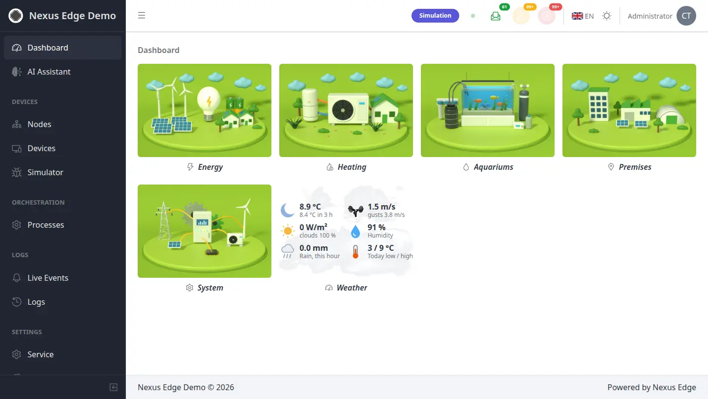
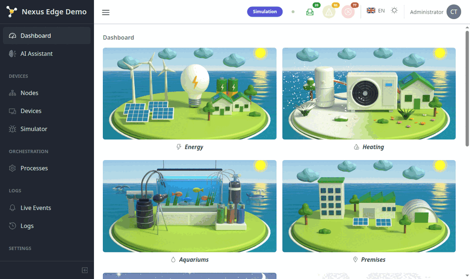
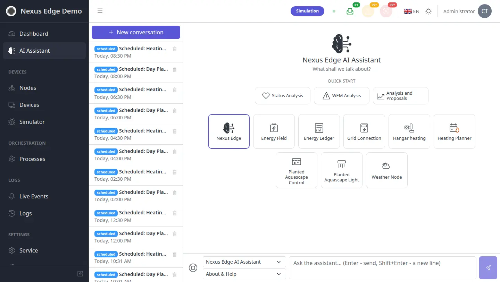
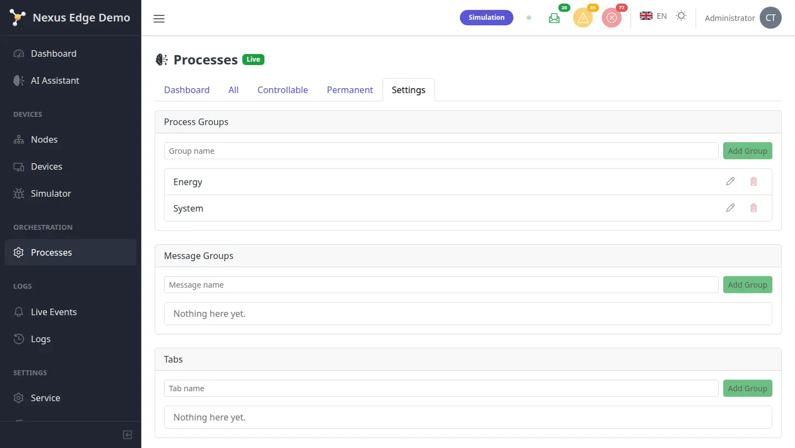
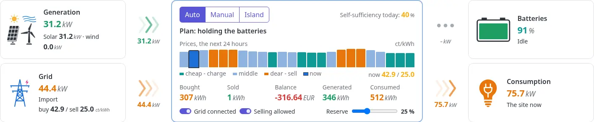
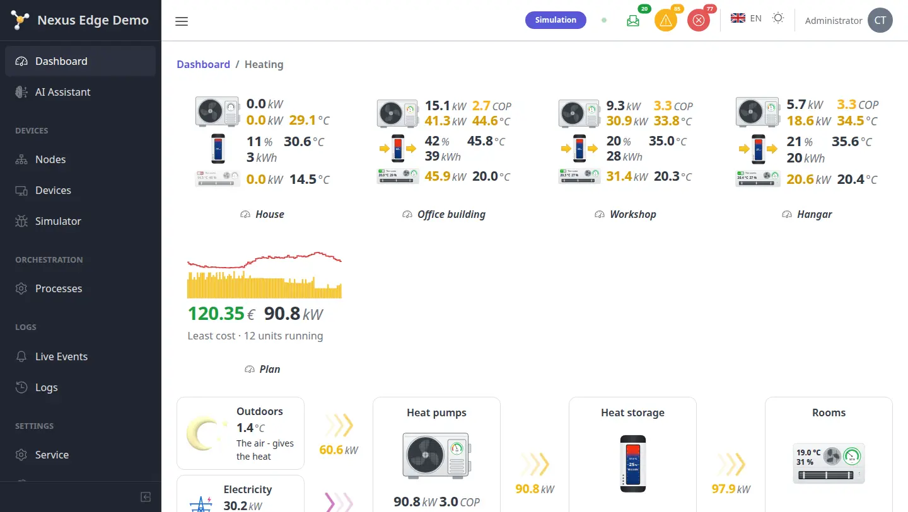

# Nexus Edge

*An edge automation platform that runs real equipment - and gets better at it
every day from its own data, with AI at every step.*

<picture>
  <source media="(prefers-color-scheme: dark)" srcset="docs/guide/_screens/dashboard-dark.webp">
  
</picture>

Nexus Edge is the open core of a platform for automation on site: one gateway
for every device and bus, a model of the whole installation, processes that
control it, a simulator that can stand in for any part of it, a web interface
for people and an AI assistant - all on the same data, on a Raspberry Pi class
computer, with no cloud needed.

- **Live demo** - [demo.nexus-edge.tech](https://demo.nexus-edge.tech): energy,
  heating and aquariums on simulated equipment, open in every role.
- **Documentation** - [nexus-edge.tech/docs](https://nexus-edge.tech/docs/):
  the user guide (English, Ukrainian, German, Spanish) and the
  [system examples](https://nexus-edge.tech/docs/examples/).
- **Quick start** - `cp .env.example .env && make up-all` ([below](#quick-start)).



## Contents

- [A constructor, not a product](#a-constructor-not-a-product)
- [Examples of target systems](#examples-of-target-systems)
- [Architecture](#architecture)
- [Quick start](#quick-start)
- [The code](#the-code)
- [Tech stack](#tech-stack)
- [Status](#status) - [License](#license) - [Author](#author)

## A constructor, not a product

The core knows no house, no plant and no aquarium. It gives the parts a system
is built from; a target project composes them and adds its own.

### The Dashboard

A site as a **tree of cards**: a folder per level (a building, a system), an
avatar per live unit - its small picture opens it - and components drawn at a
level's full width. What a person sees follows their role: a card shows only
where the role sees its object. Every popup is the same: the live status with
its charts, the Library model, the photo, the place on the map.
[The Dashboard](https://nexus-edge.tech/docs/platform/dashboard/) -
[the common elements](https://nexus-edge.tech/docs/platform/common/).

A **component** is a package's own view on the Dashboard. The demo's navigator
is one - the storeys as 3D maps with their rooms' status, a tree with a search,
the zones as strips - built by the demo project, not by the core:

<picture>
  <source media="(prefers-color-scheme: dark)" srcset="https://nexus-edge.tech/docs-screens/demo-navigator-dark.webp">
  
</picture>

### The AI Assistant - at every step, under control

<picture>
  <source media="(prefers-color-scheme: dark)" srcset="docs/guide/_screens/ai-assistant-dark.webp">
  
</picture>

- One assistant for the whole system and one for each package instance:
  install, configure, watch, analyse, control, propose, report. The AI button
  on any card opens a conversation about that object.
- **Access levels** per area - Off / Confirm (a person accepts each change) /
  Auto (applied, logged with its author); roles limit what it sees.
- **Scheduled runs** - e.g. the day plan for energy and heating, the daily
  report; every token counted by day (guests, schedules, people) against the
  limits.
- **MCP** - the same tools for your own agents (`/api/mcp`): each token has its
  own service account whose roles decide what it reads and changes; every call
  logged.
- OpenAI, Anthropic or a **local model** (Ollama, LM Studio, vLLM) - the data
  can stay on site; the keys encrypted.

[The AI Assistant](https://nexus-edge.tech/docs/ai/).

### Processes and their settings

<picture>
  <source media="(prefers-color-scheme: dark)" srcset="docs/guide/_screens/processes-settings-dark.webp">
  
</picture>

A process is a package's control loop on the orchestrator's tick: its config
(sections checked against the kind's JSON schema; a change made meanwhile by
someone else is refused, not overwritten), its commands, its state and
metrics, its warnings and errors (levels, groups, the operator's sound and LED
signalling). A process may **act as** a person - their rights, their name in
the logs. What a kind's settings mean - each module's page:
[processes](https://nexus-edge.tech/docs/platform/processes/),
[the modules](https://nexus-edge.tech/docs/modules/).

### Nodes, devices, simulation

Every node and device is **physical or simulated**, switched live; a model
state validator rejects a physically forbidden state before it reaches the
hardware; a node keeps its own safety limits with no link to the server.
Equipment comes into the system from its type in the Library to the real
hardware in five steps -
[your equipment](https://nexus-edge.tech/docs/getting-started/your-equipment/).

## Examples of target systems

What target projects build with the core - the demo runs all of them
([system examples](https://nexus-edge.tech/docs/examples/)).

**Energy** - PV, wind, batteries and the grid by the day-ahead prices: a plan
for every 15 minutes, strategies (least cost, self-sufficiency, a reserve
before a storm, peak shaving) fixed or chosen by the most similar recorded
days, island mode, and the **Ledger** - what was saved and paid, by day and by
account (the buildings, the tenants). The energy field, the grid connection
and the ledger are in this repository (`devices/processes/`).
[Energy in the demo](https://nexus-edge.tech/docs/examples/energy/).

<picture>
  <source media="(prefers-color-scheme: dark)" srcset="docs/guide/_screens/energy-overview-dark.webp">
  
</picture>

**Heating** - heat pumps with staged starts, buffer tanks as heat storage
(store when cheap or sunny, hold off when dear - SG-Ready), every room with its
setpoint, one planner shifting the heat into the cheap hours by its strategy.
In this repository (`heating-control`, `heating-planner`).
[Heating in the demo](https://nexus-edge.tech/docs/examples/heating/).

<picture>
  <source media="(prefers-color-scheme: dark)" srcset="docs/guide/_screens/heating-overview-dark.webp">
  
</picture>

**Aquariums** - a private package on the same core: the light by a target of
Wh per day with spectrum templates, curves and seasons computed back from it;
CO2 by pH, dosing, water quality, equipment, maintenance - a tank designed to
run for months on its own.
[Aquariums in the demo](https://nexus-edge.tech/docs/examples/aquariums/).

<picture>
  <source media="(prefers-color-scheme: dark)" srcset="https://nexus-edge.tech/docs-screens/aquarium-dark.webp">
  
</picture>

## Architecture

```
 sensors, actuators --> nodes (STM32, ESP32) --> bus (CAN, MQTT, ...) --\
                                                                        >--> device-service --> EdgeX --> api
 virtual devices ----> simulation processes ----------------------------/                               |
                                                                                                         v
   people (UI, WebSocket push) <-- messaging-gateway <-- RabbitMQ <-- orchestrator (processes) <-- the model
                                                                          ^
                                                     AI Assistant, MCP ---/
```

- **One gateway** - EdgeX Foundry underneath; a custom Go device-service for
  CAN (a `PhysicalTransport` interface - the next bus is a package, not a
  rewrite) and MQTT for network nodes; virtual devices for the simulation.
- **The model** - nodes, devices and their roles, the processes that use them,
  the Dashboard's tree; PostgreSQL + TimescaleDB (the series with continuous
  aggregates), Redis for the live values.
- **The event bus** - RabbitMQ mirrors the physical buses: a value, a command,
  a state change, a message; the messaging gateway pushes them to the UI by the
  person's scope.
- **The orchestrator** - every process's tick, the commands, the alarms; the
  heavy computations in a worker.
- **Access** - roles over objects (DNP instances) and sections, server-side
  sessions, a guest, service accounts; one permission catalog for the API's
  guard, the UI and the AI.

## Quick start

Requirements: Docker with Compose v2. Everything builds and runs in
containers.

```
cp .env.example .env
make up-all
```

It starts the platform (PostgreSQL, Redis, RabbitMQ, orchestrator, api,
messaging-gateway, ui) with the EdgeX core and the device-service. The first
login is `admin` with `ADMIN_DEFAULT_PASSWORD` from `.env` - change it before
running anywhere reachable. Every value (ports, keys, limits) is in `.env`;
every target - in the `Makefile`. A project of your own on the
core: `make new-project` ([extending](https://nexus-edge.tech/docs/extending/),
`docs/CREATING_A_TARGET_PROJECT.md`). Installing on a server or a Pi, backups,
updates - [operations](https://nexus-edge.tech/docs/operations/).

## The code

A pnpm + Turborepo monorepo in TypeScript (the device-service in Go).
`AGENTS.md` is the living technical reference - every mechanism, how and why,
section by section; this is the map.

```
apps/
  api/                 Fastify - the model, the routes, the AI, the migrations
  orchestrator/        the processes' tick, commands, alarms, the compute worker
  messaging-gateway/   WebSocket push from RabbitMQ, by the person's scope
  ui/                  React + Vite (CoreUI), i18next - the web interface
  device-service/      Go - EdgeX device-service: CAN, MQTT, virtual devices
devices/               the Library - the public packages (DNP)
  nodes/<type>/        node.yaml, library.json, docs/, the model's picture
  standalone/<type>/   single devices (sensor, actuator, input, indicator, speaker)
  processes/<kind>/    library.json, process.ts, api.ts, model.ts, ui/, docs/
  lib/                 shared helpers of the packages (local time, WEM)
plugins/               a target project's own packages (empty in the core)
templates/             target-project/ - what `make new-project` generates
docs/guide/            the user guide - one source for the UI, the site, the AI
config/                the device MQTT broker's configuration
scripts/               tooling - translations, new projects, process kinds
```

### apps/api

- `src/server.ts`, `index.ts` - Fastify, the plugins, the start (migrations,
  then the routes).
- `routes/` - one file per area: `nodes`, `devices`, `processes`, `registry`
  (create / delete), `series`, `logs`, `dashboardCards`, `users`, `access`,
  `ai`, `service`, `dnp` (a package's own routes), ...
- `access/` - the permission `catalog.ts` (section -> block -> action, one tree
  for the guard, the UI and the AI), `rights.ts` (a role's table -> the
  actions per unit), `principal.ts` (who asks and what they may), `guard.ts` /
  `routes.ts` (every route's permission), `scope.ts` (lists cut to what a
  person sees), `session.ts`, `guestSettings.ts`.
- `ai/` - `agent.ts` (a conversation: the prompts, the tools loop, the token
  limits, the usage by day), `tools.ts` (the gateway's tool registry - read
  tools and proposing ones), `proposals.ts` (Confirm / Auto, applied as their
  author), `mcp.ts` (the MCP server, its tokens and service accounts),
  `instances.ts` (the assistants and their access levels), `calendar.ts`
  (scheduled runs), `docs.ts` (the documentation search), `openaiClient.ts` /
  `anthropicClient.ts`, `manifests.ts` (a package's AI work types).
- the model and its writes - `registry.ts`, `processWrites.ts` (config with
  stamps, commands, switching), `dualDevicesModel.ts` / `validator.ts`
  (physical / simulated, the forbidden states), `edgex.ts`, `timeSeries.ts`,
  `dnpInstances.ts` (which unit an object belongs to), `systemStamps.ts`
  (backup / restore).
- `migrations/` - node-pg-migrate, numbered; a project's own SQL migrations run
  after them (`extraMigrations.ts`).
- `prompts/` - the AI's system prompts; a package adds its own.

### apps/orchestrator

`tickProcesses.ts` runs every process on its interval (`processDispatch.ts`,
the kinds from `kindPackages.ts` / `processPlugins.ts`); `processes/` - the
core's own (heartbeat control, resource monitor, data logger, AI assistant
runs); `alarmPolicy.ts` / `messageSettle.ts` - warnings and errors with their
levels; `computeWorker.ts` - the heavy calculations off the tick;
`valueBatcher.ts` - the device writes.

### apps/ui

`views/` - one folder per page (dashboard, devices, processes, logs, service,
users, library, ai, docs); `components/` - the shared parts (tables, popups,
charts, indicators, the AI messenger); `*Registry.js` - where a package's UI
plugs in (`processTypeRegistry`, `deviceTypeRegistry`, `dashboardRegistry`);
`i18n/` - the core's texts (a package's own - in its `ui/locales/`); `hooks/`
(`usePersistedState`, pagination, expandable rows); `api/` - the REST client
and the live values over the WebSocket.

### A package (DNP)

`devices/processes/<kind>/`: `library.json` (the catalog entry - kind, name,
the node types it needs), `process.ts` (the orchestrator's tick: read the
devices, decide, write, publish metrics and messages), `api.ts` (the config's
JSON schema, its routes, the AI tools), `model.ts` (the pure calculations,
unit-tested), `ui/` (its panel, its Dashboard scene and avatar, its settings,
`register.js`, `locales/`), `docs/` (read by the AI). A node type -
`devices/nodes/<type>/node.yaml` (its devices and limits). A target project
adds its packages to its own `plugins/` the same way.

## Tech stack

| Layer | Choice |
|---|---|
| Runtime | Node.js 22, TypeScript, pnpm workspaces + Turborepo |
| Backend | Fastify, Pino, node-pg-migrate, Ajv |
| Storage | PostgreSQL 16 + TimescaleDB, Redis 7 |
| Messaging | RabbitMQ 4, WebSocket gateway |
| Hardware hub | EdgeX Foundry 4.0, a Go device-service (CAN, MQTT) |
| UI | React + Vite (based on the CoreUI admin template), i18next |
| AI | OpenAI / Anthropic / OpenAI-compatible APIs, MCP |

## Status

Actively developed; running the public demo. `AGENTS.md` - the technical
reference; `docs/DEVELOPMENT_LOG.md` - the dated decisions. Planned: several
buses at once, a wider automated test suite, more industry examples in the
demo.

## License

Apache License 2.0 - see `LICENSE` and `NOTICE`. Use, modify and distribute,
also commercially; keep the licence and the notices, mark your changes.
Private packages built on the core may stay private (the aquarium package is
one). `apps/ui` is based on the CoreUI Free React Admin Template (MIT) - see
`apps/ui/THIRD-PARTY-LICENSE-CoreUI.txt`.

## Author

Nexus Edge - the platform, its packages and the ideas behind them - is
designed and built by **Anatolii Semochko**.

- Site - [nexus-edge.tech/author](https://nexus-edge.tech/author/)
- E-mail - [anatoliy.semochko@gmail.com](mailto:anatoliy.semochko@gmail.com)
- LinkedIn - [linkedin.com/in/anatolii-semochko](https://www.linkedin.com/in/anatolii-semochko/)
